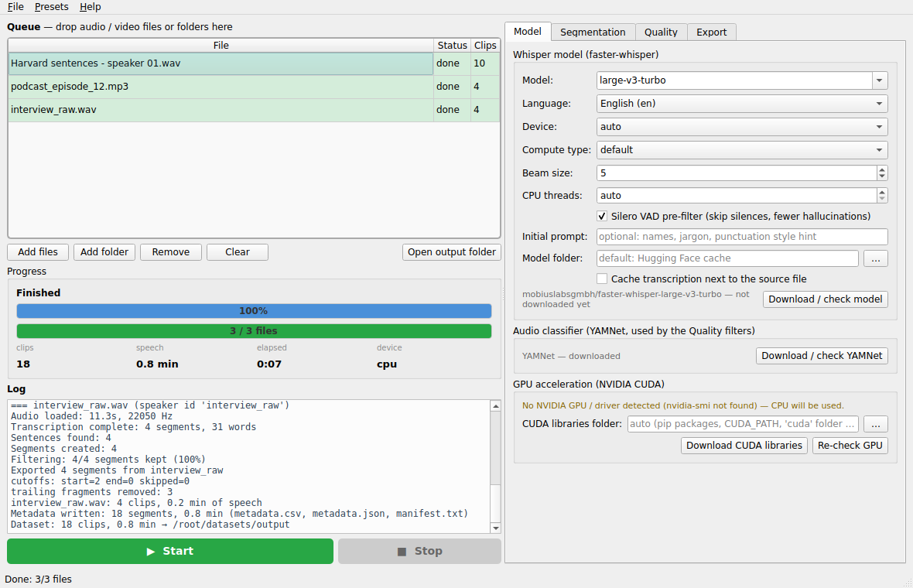

# speech-splitter

Turn any audio (or video) into a **TTS training dataset**: drop files in, press *Start*, get clean
sentence-length clips with matching transcripts and a Hugging Face-ready `metadata.csv`.



## What it does

1. **Transcribes** with [faster-whisper](https://github.com/SYSTRAN/faster-whisper) (CTranslate2) using word-level
   timestamps — any language, CPU or NVIDIA GPU, models download on first use.
2. **Splits by sentence** (`.` `!` `?` in any script, numbers like `3.5` never split). Short sentences are merged with
   the next one, overlong ones are split at the longest pause; clips always end at the last word, never at the next word's start.
3. **Filters** with [YAMNet](https://www.kaggle.com/models/google/yamnet) (AudioSet classifier, runs on onnxruntime):
   music, singing, speech over music, noise, silence — plus Whisper's own word confidence and optional
   *drop first/last segments* for intros / outros.
4. **Exports** each clip with boundary buffers that extend into the surrounding pause but never into the neighbouring
   word, silence trimming, stray-fragment removal and optional *cutoff detection* (clips with a clipped first/last word
   are skipped or tagged `_CUTSTART` / `_CUTEND`).

```
output/
  audio/        speaker_0001.wav …        (wav / flac / mp3, original or chosen sample rate)
  transcripts/  speaker_0001.txt …
  metadata.csv  file_name,transcription,duration   <- Hugging Face AudioFolder
  metadata.json full per-clip info (confidence, classification scores, flags)
  manifest.txt  audio|transcript pairs
  logs/
```

## Install

Grab a prebuilt binary from the [latest release](https://github.com/hclivess/speech-splitter/releases/latest)
(Windows / Linux / macOS, no Python needed), or run from source:

```
pip install -r requirements.txt
python speech_splitter_gui.py        # GUI   (run.cmd / run.sh do the same)
python speech_splitter.py --help     # CLI
```

You also need [FFmpeg](https://ffmpeg.org/) in `PATH` or next to the app for anything other than plain WAV input.

### GPU (NVIDIA)

faster-whisper runs on CUDA 12 and needs cuBLAS 12 + cuDNN 9. Either `pip install -r requirements-cuda.txt`,
or use **Model → Download CUDA libraries** in the app (official NVIDIA wheels from PyPI, ~1 GB, resumable, stored in a
`cuda` folder next to the app). The Model tab shows the GPU, the driver and which libraries were found; leave *Device*
on `auto`. Expect ~10–30× realtime with `large-v3-turbo` on a mid-range card vs ~1–3× on a CPU with `small`.

## Settings

| Tab | |
|---|---|
| **Model** | model (any size or Hugging Face repo id), language / auto-detect, device, compute type, beam size, VAD, initial prompt, model folder, transcription cache, YAMNet + CUDA downloads, GPU status |
| **Segmentation** | min / max clip length, merge short sentences, what to do with overlong ones (split / tag / skip), start & end buffers, cutoff detection (mode, sensitivity, skip / tag / keep) |
| **Quality** | min word confidence, music / mixed / noise / silence thresholds, edge-segment removal |
| **Export** | output folder, speaker id (numbering continues across runs), wav / flac / mp3, sample rate, silence trimming, fragment removal |

**Presets** menu: Fast / Balanced / Strict, plus save / load / import / export your own and *save as defaults*.

Transcriptions are cached next to the source as `<file>.transcription.json` (tagged with the model used) — re-running
with different segmentation / filter settings is instant.

## CLI

```
python speech_splitter.py audiobook/ -o dataset --model large-v3 --language cs --speaker-id jan \
    --min-length 1.5 --max-length 12 --check-cutoff --filter-noise --min-confidence 0.6
```

All GUI options exist as flags (`--help`). Folders are searched recursively.

## Tips

- **Words still clipped?** Lower `--cutoff-sensitivity`, or raise the buffers a little (they can't cut into words anyway).
- **Too many clips rejected?** Raise `--music-threshold` / `--mixed-threshold`, lower `--min-confidence`, or turn off
  `--filter-noise` for room-tone recordings.
- **Proper names wrong?** Put them into the *initial prompt*; Whisper copies their spelling.
- **Garbage at file edges** (jingles, "thanks for listening")? *Drop first / last segments*.
- The `tools/` folder has helpers for chunking large datasets into parquet shards and converting wav → mp3.

## Build

`pip install -r requirements.txt pyinstaller && python build.py` produces `dist/speech-splitter-<version>-<os>-<arch>`.
The GitHub workflow builds all three platforms on every tag and attaches them to the release; the Linux build runs a
headless self-test (`SPEECH_SPLITTER_SELFTEST=<audio file>`).

## Changes in 3.0.1

- Helper processes (ffmpeg / ffprobe decoders started by pydub, nvidia-smi) are tracked and killed when the app quits, is stopped, or crashes — Windows Job object, Linux parent-death signal
- No partial output files: clips, transcripts, metadata.csv / metadata.json / manifest.txt, the transcription cache and presets are written to a temporary name and renamed into place when complete; the run log is `.log.part` until the run finishes
- Adding files or folders never queues the same path twice (status bar reports "n already in queue")
- Folder scans, the queue, output listings and presets use natural order (`take2 < take10`)

## Changes in 3.0

- faster-whisper replaces WhisperX (no torch / pyannote; word timestamps built in; CUDA libraries downloadable in-app)
- YAMNet runs on onnxruntime instead of TensorFlow — the app is a ~270 MB standalone download instead of a
  Python 3.10 virtualenv with 5 GB of dependencies
- new GUI in the style of [whisperer](https://github.com/hclivess/whisperer) / [videer](https://github.com/hclivess/videer):
  queue with per-file status, live progress, presets, GPU panel, model downloads
- sentence splitting works for all languages (was ASCII-only); short sentences are merged instead of dropped;
  long sentences are split at pauses instead of just being tagged `_LONG`
- end buffers no longer cut into the next word; `metadata.csv` is now valid for Hugging Face AudioFolder
  (`audio/…` paths, `transcription` column); transcription cache is invalidated when the model changes
- fixed: the CLI could not start (duplicate `--check-cutoff` / `--cutoff-action` flags, missing `--min-confidence`),
  crash when YAMNet was unavailable, *filter silence* and *trim silence* toggles being ignored
- DeepFilterNet enhancement was removed (needed torch and a CPU-only monkeypatch); run your audio through a
  denoiser first if you need it
