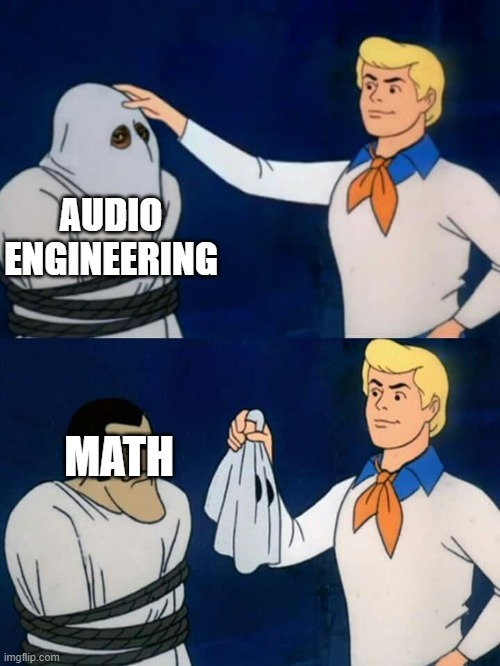

# Speech Splitter v2 - Advanced TTS Data Generator

## Downsides: 
- Whisper transcription does not always get proper names right



Advanced audio segmentation tool for TTS training data preparation with intelligent music detection, hybrid pause validation, and validated audio buffering.

## Features

- **Whisper Transcription** - Single-pass transcription with word-level timestamps
- **Hybrid Pause Detection** - Combines Whisper timestamps with YAMNet audio validation
- **YAMNet Music Filtering** - Neural network-based music detection and removal
- **Validated Audio Buffers** - Smart buffering that only extends into verified silence
- **Cutoff Detection** - Identifies and handles segments with cut-off words
- **Quality Filtering** - Multi-stage filtering with confidence scoring
- **No Audio Resampling** - Preserves original sample rate throughout pipeline
- **HuggingFace Compatible** - Generates metadata.csv for dataset publishing
- **Batch Processing** - Process multiple files at once
- **GUI & CLI** - Choose your preferred interface

## What Gets Filtered

YAMNet automatically detects and removes:
- ✅ Pure music segments (instrumental, vocal music)
- ✅ Speech with background music
- ✅ Songs with lyrics
- ✅ Musical interludes
- ✅ Low quality/noisy segments
- ✅ Low confidence transcriptions
- ✅ False pauses (Whisper timestamp gaps that contain actual speech)
- ✅ Segments with cut-off words at boundaries (optional)

## Installation

**Important:** Use a virtual environment to avoid compatibility issues between TensorFlow, YAMNet, and other dependencies.

### Step 1: Create Virtual Environment

**Windows:**
```bash
python -m venv .venv
call .venv\Scripts\activate
```

**Linux/macOS:**
```bash
python -m venv .venv
source .venv/bin/activate
```

### Step 2: Install Python Dependencies

```bash
pip install -r requirements.txt
```

This installs:
- OpenAI Whisper
- YAMNet (TensorFlow + TensorFlow Hub)
- pydub
- PySide6 (GUI)
- tqdm
- numpy
- Other dependencies

### Step 3: Install ffmpeg

**Ubuntu/Debian:**
```bash
sudo apt-get install ffmpeg
```

**macOS:**
```bash
brew install ffmpeg
```

**Windows:**
Download from https://ffmpeg.org/download.html and add to PATH

## Output Structure

```
output/
  audio/
    speaker_0001.wav
    speaker_0002.wav
    speaker_0003.wav
    ...
  transcripts/
    speaker_0001.txt
    speaker_0002.txt
    speaker_0003.txt
    ...
  metadata.json
  metadata.csv       # HuggingFace compatible
  manifest.txt
```

**metadata.csv format (HuggingFace):**
```csv
file_name,text
speaker_0001.wav,"Hello, this is the first segment."
speaker_0002.wav,"This is the second segment."
```

## Usage

### GUI Application

```bash
python speech_splitter_gui_v2.py
```

**GUI Features:**
- Drag and drop file selection
- Real-time processing logs
- Configurable settings with tabs:
  - **Basic**: Model, language, output settings
  - **Segments**: Length and buffer controls
  - **Quality**: Confidence and noise filtering
  - **Music Filter**: YAMNet settings and thresholds
  - **Pause Detection**: Hybrid validation settings
  - **Cutoff Detection**: Cut-off word handling
- Settings auto-save and restore

**Pause Detection Tab:**
- **Hybrid Pause Detection**: Validates all Whisper timestamp pauses with YAMNet
  - First check: Whisper identifies pause by timestamp duration
  - Second check: YAMNet confirms the gap contains actual silence
  - Rejects "pauses" that contain speech or significant audio
- **Pause Speech Threshold**: Lower = stricter validation (default: 0.2)

**Music Filter Tab:**
- Enable/disable YAMNet filtering
- Adjust music detection threshold (default: 0.3)
- Adjust mixed content threshold (default: 0.2)
- Lower values = more aggressive filtering

**Cutoff Detection Tab:**
- Detects segments where words are cut off at boundaries
- Actions: rename (add suffix), skip (discard), or include (keep)
- Checks first/last 50ms of each segment with YAMNet

### Command Line

**Basic usage:**
```bash
python speech_splitter_v2.py input.mp3
```

**With options:**
```bash
python speech_splitter_v2.py input.mp3 \
  --model large \
  --language en \
  --output-dir output \
  --speaker-id "john_smith" \
  --filter-music \
  --music-threshold 0.3 \
  --mixed-threshold 0.2 \
  --hybrid-pause-detection \
  --pause-speech-threshold 0.2 \
  --word-start-buffer 250 \
  --word-end-buffer 750 \
  --check-cutoff \
  --cutoff-action rename
```

**All options:**
```
Model & Language:
--model              Whisper model: tiny, base, small, medium, large, large-v2 (default: large)
--language           Language code: en, cs, de, es, fr, it, pl, ru (default: cs)
--output-dir         Output directory (default: output)
--speaker-id         Speaker identifier (default: filename)
--format             Output format: wav, mp3 (default: wav)

Segmentation:
--min-length         Min segment length in seconds (default: 1.0)
--max-length         Max segment length in seconds (default: 15.0)
--pause-threshold    Pause duration threshold in seconds (default: 0.5)
--word-start-buffer  Buffer at segment start in ms (default: 250)
--word-end-buffer    Buffer at segment end in ms (default: 750)

Pause Detection:
--hybrid-pause-detection      Enable hybrid pause validation (default: True)
--pause-speech-threshold      Speech probability threshold for pauses (default: 0.2)

Quality Filtering:
--min-confidence              Min transcription confidence 0.0-1.0 (default: 0.5)
--filter-noise                Enable noise filtering (default: True)
--noise-silence-threshold     Silence threshold for noise filter (default: 0.3)

Music Filtering:
--filter-music       Enable YAMNet music filtering (default: True)
--music-threshold    Music detection threshold (default: 0.3)
--mixed-threshold    Music+speech detection threshold (default: 0.2)

Cutoff Detection:
--check-cutoff                Enable cutoff detection (default: True)
--cutoff-boundary-ms          Boundary duration to check in ms (default: 50)
--cutoff-silence-threshold    Silence threshold for cutoff (default: 0.3)
--cutoff-action               Action: rename, skip, or include (default: rename)

Buffer Validation:
--buffer-validation-threshold Threshold for buffer zone validation (default: 0.3)
```

## Processing Pipeline

The tool uses an intelligent single-pass pipeline:

```
1. Load Audio (preserve original sample rate)
   ↓
2. Whisper Transcription (single pass, word timestamps for entire file)
   ↓
3. Hybrid Pause-based Segmentation
   - Split by pauses in Whisper word timestamps (>= pause_threshold)
   - Validate each pause with YAMNet audio analysis
   - Reject "pauses" that contain speech/noise
   ↓
4. Music Filter (YAMNet classification)
   ↓
5. Noise Filter (YAMNet silence detection)
   ↓
6. Confidence Filter (Whisper probability scores)
   ↓
7. Text Validation (pattern matching, length checks)
   ↓
8. Smart Buffer Application
   - Validate buffer zones with YAMNet before extending
   - Only extend into verified silence
   - Prevent cutting into adjacent words
   ↓
9. Cutoff Detection (optional, checks segment boundaries)
   ↓
10. Export (original sample rate preserved, HuggingFace metadata generated)
```

**Key Improvements in v2:**
- **Single-pass transcription** - No redundant processing
- **Hybrid pause detection** - Prevents false splits in continuous speech
- **Validated buffers** - Only extends into actual silence, not neighboring words
- **No resampling** - Preserves original audio quality
- **Better segmentation** - Fewer cut-off words and false pauses

## How Hybrid Pause Detection Works

Traditional timestamp-based segmentation has a critical flaw: Whisper sometimes reports "pauses" (gaps in word timestamps) even when audio is continuous. This causes words to be split mid-utterance.

**Hybrid Detection Solution:**

1. **First Check (Whisper)**: Identify potential pauses by timestamp gaps
   - If gap between words >= `pause_threshold` (e.g., 0.5s), it's a candidate

2. **Second Check (YAMNet)**: Validate the gap contains actual silence
   - Extract audio from the gap
   - Classify with YAMNet neural network
   - Confirm high silence score OR low speech/music scores

3. **Decision**: Split only if BOTH checks pass
   - ✓ Whisper says pause AND YAMNet confirms silence = Valid pause, split here
   - ✗ Whisper says pause BUT YAMNet detects speech = False pause, keep together

**Result**: Dramatically reduces mid-word cuts and improves segment quality.

## Smart Buffer Validation

Buffers extend segment boundaries to capture complete word beginnings/endings. But naive buffering can cut into adjacent words!

**The Problem:**
```
Word A ends ──┐   ┌── Word B starts
              ↓   ↓
Audio:    ...A]   [B...
          ↑     ↑     ↑
Naive buffer extends blindly and cuts into Word A/B
```

**Smart Buffer Solution:**

1. **Attempt to extend** segment boundaries by buffer duration (e.g., 250ms start, 750ms end)
2. **Validate buffer zone** with YAMNet audio analysis
3. **Accept buffer** only if zone contains silence/pause
4. **Reject buffer** if zone contains speech/music
5. **Fall back** to exact Whisper word boundaries if rejected

**Result**: Buffers only extend into silence, never into neighboring speech.

## Configuration Examples

### Default Settings (Recommended)
Good balance for most audio:
```bash
python speech_splitter_v2.py podcast.mp3
```

### Aggressive Filtering
For noisy audio with lots of music:
```bash
python speech_splitter_v2.py recording.mp3 \
  --music-threshold 0.2 \
  --mixed-threshold 0.15 \
  --min-confidence 0.6 \
  --filter-noise \
  --noise-silence-threshold 0.2 \
  --pause-speech-threshold 0.15
```

### Conservative Filtering
For clean audio, only filter obvious issues:
```bash
python speech_splitter_v2.py lecture.mp3 \
  --music-threshold 0.5 \
  --mixed-threshold 0.4 \
  --min-confidence 0.4 \
  --pause-speech-threshold 0.3
```

### Maximum Quality (Strict)
For TTS training data that must be perfect:
```bash
python speech_splitter_v2.py audio.mp3 \
  --model large-v2 \
  --min-confidence 0.7 \
  --music-threshold 0.25 \
  --check-cutoff \
  --cutoff-action skip \
  --pause-speech-threshold 0.15
```

### Fast Processing
Disable some features for speed:
```bash
python speech_splitter_v2.py audio.mp3 \
  --model base \
  --no-filter-music \
  --no-hybrid-pause-detection \
  --no-check-cutoff
```

### Batch Processing
Process multiple files:
```bash
for file in audio/*.mp3; do
  python speech_splitter_v2.py "$file" --speaker-id "$(basename "$file" .mp3)"
done
```

Or process entire directory:
```bash
python speech_splitter_v2.py audio_directory/
```

## Troubleshooting

**Words are still cut off:**
- Increase buffer validation threshold: `--buffer-validation-threshold 0.4`
- Reduce buffer sizes: `--word-start-buffer 100 --word-end-buffer 200`
- Use stricter pause validation: `--pause-speech-threshold 0.15`

**Too many segments rejected:**
- Relax music threshold: `--music-threshold 0.4`
- Relax confidence: `--min-confidence 0.4`
- Disable cutoff detection: `--no-check-cutoff`

**Segments split in wrong places:**
- Enable hybrid detection: `--hybrid-pause-detection`
- Adjust pause threshold: `--pause-threshold 0.7`
- Lower pause speech threshold: `--pause-speech-threshold 0.15`

**Processing too slow:**
- Use smaller model: `--model base`
- Disable music filtering: `--no-filter-music`
- Disable cutoff detection: `--no-check-cutoff`

## Output Files Explained

**metadata.json**: Complete segment information with durations and sample rates

**metadata.csv**: HuggingFace-compatible format for dataset uploads

**manifest.txt**: Simple pipe-delimited mapping of audio to transcript files

**Cutoff filename suffixes** (when `--cutoff-action rename`):
- `_CUTSTART`: Word cut off at beginning
- `_CUTEND`: Word cut off at end
- `_CUTBOTH`: Words cut off at both boundaries

For issues or questions, report on the repository.